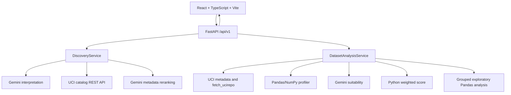

# Architecture

Last verified: 2026-10-24

## Overview

ResearchLens is a small React/Vite frontend backed by a synchronous FastAPI service. The backend obtains dataset facts from UCI, uses Gemini only for semantic interpretation and assessment, and uses Pandas/NumPy for deterministic profiling.

## Modules

Backend modules are organized by responsibility:

- `app/api`: FastAPI routes and Pydantic schemas
- `app/discovery`: UCI adapter and catalog search/ranking
- `app/profiling`: deterministic profile generation
- `app/analysis`: orchestration, caching, and exploratory summaries
- `app/assessment`: Gemini integration and Python scoring
- `app/demo.py`: explicitly selected verified cached demo values
- `app/config.py`: environment-backed settings

The frontend currently concentrates workflow UI in `src/App.tsx`, with API types in `src/types.ts` and presentation rules in `src/styles.css`.

## Research workflow

1. The researcher submits a question.
2. Gemini interprets concepts when available; deterministic keyword interpretation is the fallback.
3. UCI catalog metadata is retrieved and filtered.
4. A bounded set of candidates is enriched from UCI metadata.
5. Gemini may rerank only verified candidate metadata.
6. The user expands a result and requests analysis.
7. `fetch_ucirepo` supplies the original DataFrame.
8. Pandas/NumPy compute the profile.
9. Gemini may interpret verified metadata and profile evidence.
10. Python recomputes the weighted heuristic score.
11. Exploratory grouped summaries and SVG visualization are available for compatible variables.

Preliminary relevance is a metadata-only discovery signal. Research suitability requires inspected tabular data and deterministic statistics. Neither is proof of causation or scientific validity.

## External integrations

- UCI catalog endpoint: `https://archive.ics.uci.edu/api/datasets/list`
- UCI metadata endpoint: `https://archive.ics.uci.edu/api/dataset`
- `ucimlrepo.fetch_ucirepo` for tabular retrieval
- Official `google-genai` SDK for Gemini

## Resilience

The discovery service uses process-local caches, bounded candidate enrichment, explicit fallback modes, timeouts, and bounded Gemini retries. Dataset analysis caches by dataset and normalized question. DEMO_MODE bypasses external calls for its supported cached workflow.

## Limitations

There is no persistent database, authentication, job queue, streaming, distributed cache, deployment configuration, or multi-repository adapter beyond UCI. Process-local caches disappear on restart. Gemini availability and quota remain external dependencies.
