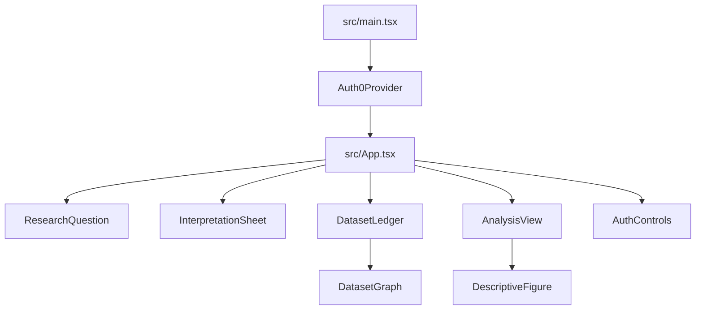
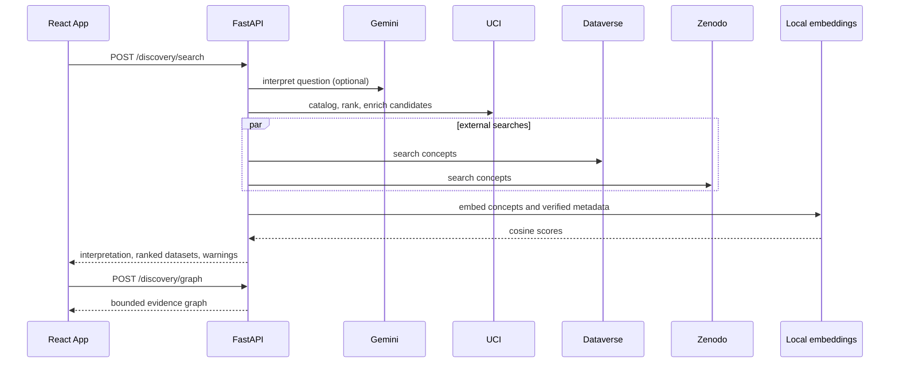
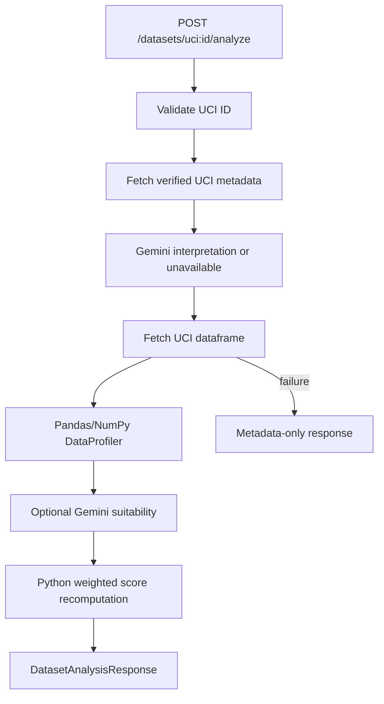

# ResearchLens / DataOPedia — Current Project Handoff

> Audit date: 2026-10-25  
> Repository: `anhducnguyen2006/hackpsu-project`  
> Authority: the checked-out repository, including tracked source, tests, manifests, and Git history.  
> Scope: static code inspection plus safe local verification. No application code, dependencies, external APIs, or databases were modified.

## 1. Executive Summary

The current project is a React/Vite frontend and FastAPI backend for turning a natural-language research question into verified dataset metadata, a metadata evidence graph, deterministic statistical profiles, and (when configured) Gemini-generated interpretation and suitability commentary.

The repository is clean on `main` at commit `c69c0cb`, which is also `origin/main`. The implementation is no longer UCI-only. Discovery combines:

* UCI Machine Learning Repository catalog and metadata enrichment.
* Harvard Dataverse search.
* Zenodo published-record search.
* Local Sentence Transformers embeddings for semantic ranking.
* A deterministic NetworkX knowledge graph serialized for Cytoscape.

Analysis remains UCI-only. The live frontend deliberately enables analysis only for `uci:*` records, even though discovery can display Dataverse and Zenodo records. No download endpoint exists; Zenodo download resources are metadata returned in discovery results, not downloaded by the application.

Gemini is used for question interpretation and has implemented methods for preliminary reranking and full suitability assessment. The normal discovery path currently performs local semantic ranking instead of Gemini reranking. Suitability assessment is invoked only after a successful UCI data fetch/profile and is optional: verified deterministic profile data is preserved if Gemini is unavailable.

There is no database, SQLAlchemy layer, migration system, Redis, vector database, user persistence, history, saved datasets, or server-side authentication. Caches are process-local dictionaries. The frontend Auth0 provider and controls are present, but no token is sent to the backend and backend endpoints have no authentication dependency.

Static verification:

| Check | Result |
|---|---|
| `cd frontend && npm run build` | Passed; Vite build completed, with a chunk-size warning |
| `cd frontend && npm test -- --run` | Failed: 1 of 12 tests; 1 unhandled React error |
| `python3 -m compileall -q backend/app backend/tests` | Passed |
| `python3 -m pytest -q` | Blocked: pytest is not installed in the environment |
| Live Gemini/repository requests | Not run |

Confirmed current bug: the live frontend test payload omits `assumptions_or_ambiguities`; [InterpretationSheet.tsx](/Users/vantoannguyen/hackpsu-project/frontend/src/components/InterpretationSheet.tsx:33) dereferences `.length`, causing the live App test to fail. This audit does not fix it.

## 2. Repository and Technology Stack

### Project identity

The package metadata calls the frontend `research-dataset-discovery-frontend`; the UI brands itself `DataOPedia`, while the requested handoff name is ResearchLens. The backend FastAPI title is `Research Dataset Discovery API`.

### Important tree

```text
.
├── backend/
│   ├── app/
│   │   ├── main.py                 FastAPI app and router registration
│   │   ├── config.py               pydantic-settings configuration
│   │   ├── api/
│   │   │   ├── schemas.py           Pydantic request/response/domain models
│   │   │   └── routes/              health, discovery, dataset analysis
│   │   ├── discovery/               UCI, Dataverse, Zenodo, semantic ranking
│   │   ├── graph/                   deterministic NetworkX graph builder
│   │   ├── analysis/                analysis orchestration and grouped summaries
│   │   ├── profiling/               Pandas/NumPy deterministic profiling
│   │   ├── assessment/              Gemini calls and Python score recomputation
│   │   └── demo.py                  cached UCI demo objects and responses
│   ├── tests/                       pytest unit/API/service tests
│   └── requirements.txt
├── frontend/
│   ├── src/App.tsx                  stage state, fetch calls, cancellation
│   ├── src/main.tsx                 React root and Auth0 provider
│   ├── src/components/              question, interpretation, ledger, graph, analysis
│   ├── src/demo/researchExample.ts  cached UCI example
│   ├── src/types.ts                 frontend API types
│   └── src/*.css                    styling
├── docs/                            existing project docs and this handoff
├── README.md, DESIGN.md, AGENTS.md
└── .env.example
```

### Stack

* Python: FastAPI, Uvicorn, Pydantic 2, pydantic-settings, Pandas, NumPy, NetworkX, `ucimlrepo`, HTTPX, `google-genai`, Sentence Transformers.
* Frontend: React 18, TypeScript 5, Vite 5, Vitest 2, Testing Library, Cytoscape, Auth0 React SDK, Tailwind/Vite support and CSS modules-by-file convention (plain imported CSS, not a component CSS-module system).
* External services: Gemini, UCI, Harvard Dataverse, Zenodo, Auth0 browser SDK.
* Persistence: none beyond process-local memory and browser React state.

### Git state and recent changes

`git status --short --branch` reported `## main...origin/main` with no changes. Recent commits show the following current architectural additions:

* `93d094e` added Gemini prompt refinement and editable refined-question UI.
* `e562c40` added knowledge graph service/API, Zenodo/graph integration, and Cytoscape frontend.
* `473526a` added live discovery frontend wiring and backend API workflow tests.
* `3760c60` added Auth0 provider and `AuthControls`.

The old assumption “React + FastAPI + Gemini + UCI + Pandas/NumPy + cached demo” is incomplete. It remains accurate for the demo and UCI analysis path, but not for current discovery sources or graph/embedding behavior.

## 3. Current Feature Inventory

| Feature | Implemented? | Frontend location | Backend implementation | Dependencies | Limitations/status |
|---|---|---|---|---|---|
| Research-question entry | Yes | `src/components/ResearchQuestion.tsx` | `DiscoveryRequest` validates 10–2000 chars | React | Fully implemented locally |
| Gemini question interpretation | Yes | `InterpretationSheet.tsx` | `GeminiService.interpret` | Gemini key/model | Implemented but live external behavior unverified |
| Deterministic interpretation fallback | Yes | Interpretation badge | `DiscoveryService._fallback_interpretation` | Python only | Fully covered by backend tests |
| UCI discovery | Yes | `DatasetLedger.tsx` | `UCIRepositoryService`, `DiscoveryService` | `ucimlrepo` | Live external behavior unverified |
| Dataverse discovery | Yes | Dataset ledger source filter | `HarvardDataverseService` | HTTPX/Dataverse API | Metadata search only; unverified live |
| Zenodo discovery | Yes | Dataset ledger source filter | `ZenodoService` | HTTPX/Zenodo API | Metadata/resources only; unverified live |
| Local semantic ranking | Yes | Semantic score label | `EmbeddingService`, `DiscoveryService._score_concepts` | Sentence Transformers/model download | Process-local model/cache; unverified live |
| Gemini preliminary reranking | Implemented method, not normal path | None distinct | `GeminiService.rerank` | Gemini | Not called by current `_search` path |
| Dataset detail expansion | Yes | `DatasetLedger` | Returned metadata | React state | No separate detail API |
| Dataset download | No | Download formats may be shown | No download route | — | Zenodo URLs are metadata only |
| UCI profiling | Yes | `AnalysisView` | `DataProfiler` | Pandas/NumPy | Live UCI only |
| Research-variable matching | Yes | Profile evidence and graph | conservative token/substring matcher | Pandas | Heuristic; not an ontology |
| Exploratory grouped analysis | Yes | `DescriptiveFigure` | `ExploratoryAnalyzer` | Pandas | Numeric outcome, max 20 independent categories |
| Pearson correlations | Yes | API profile type; not prominently rendered | `DataProfiler._correlations` | Pandas | Association only; only matched variables |
| Statistical tests/regression/causal inference | No | UI explicitly says unavailable | None | — | Not implemented |
| Gemini suitability assessment | Yes | Analysis response/UI schema | `GeminiService.assess_suitability` | Gemini | Optional and unverified live |
| Python final score | Yes | API type; demo displays unavailable | `calculate_final_score` | Python | Recomputed from validated criteria |
| Knowledge graph | Yes | `DatasetGraph.tsx` | `/discovery/graph`, NetworkX builder | NetworkX/Cytoscape | Metadata evidence; no joinability claim |
| Cached demo mode | Yes | Static preview | `demo.py`, `DEMO_MODE` | Cached constants | Only question-family-matching demo results |
| Auth0 UI | Partially | `main.tsx`, `AuthControls.tsx` | None | Auth0 | No backend auth or token propagation |
| History/saved data/accounts | No | None | None | — | Not implemented |
| Persistent cache/database | No | None | Process-local dictionaries only | — | Lost on restart |
| Export | No | None | None | — | Not implemented |

## 4. Frontend Architecture

### Entry points and hierarchy

`src/main.tsx` mounts React under `StrictMode`, wraps it in `Auth0Provider`, and renders `App` with `AuthControls`. `App` is a single-stage workflow controller:



Stages are `question`, `interpretation`, `datasets`, `graph`, and `analysis`. There is no router. Navigation is button-driven local state.

### User journey

1. First load shows a question form, an illustrative workflow, and a cached example. The app initializes with the example analysis/exploration in preview mode.
2. “Explore the example” switches to the static cached UCI flow without network requests.
3. A live question of at least 10 characters posts to `/api/v1/discovery/search`.
4. The response supplies interpretation, source-labeled dataset cards, warnings, processing mode, and ranking status.
5. The app then posts the same question to `/api/v1/discovery/graph`; graph failures are shown separately and do not erase search results.
6. Interpretation displays subject, variables, population, synonyms, scope, terms, ambiguities, and optionally an editable Gemini refined question.
7. Dataset cards support source filtering, semantic/original sorting, detail expansion, source links, concept evidence, and analysis buttons.
8. Only UCI datasets can be analyzed live. Non-UCI records show “UCI analysis only.”
9. Analysis displays profile metrics, variable evidence, quality flags, optional grouped figure, and suitability state.
10. Graph view uses Cytoscape with node/relationship filters, focus expansion, selection, fit/reset controls, and evidence details.

### State and request lifecycle

`App` owns stage, discovery, active question, analysis, exploration, mode, loading/error state, graph, and graph loading/error state. `requestSequence` suppresses stale search responses; an `AbortController` cancels the previous search and its graph request. Analysis requests are not cancellable and do not use sequence protection.

No React context or external state manager is used. No localStorage/sessionStorage is used. Dataset expansion/filter/sort and Cytoscape selection are component-local.

### Frontend/backend contract

`getApiBase` uses `VITE_API_BASE_URL`, otherwise `http://localhost:8000` outside tests. Requests have JSON content type and no authentication header:

```json
POST /api/v1/discovery/search
{"research_question":"How is study time associated with academic performance?","limit":12}
```

```json
POST /api/v1/discovery/graph
{"research_question":"How is study time associated with academic performance?","limit":12}
```

```json
POST /api/v1/datasets/uci%3A320/analyze
{"research_question":"How is study time associated with academic performance?"}
```

The frontend types in `src/types.ts` broadly mirror Pydantic models. A notable compatibility issue is that the live App test fixture lacks `assumptions_or_ambiguities`, while `InterpretationSheet` assumes it is always present. TypeScript does not catch this because the test casts the payload.

### Extension points

* Add frontend workflow state and API call in `App.tsx`.
* Add display-specific API types in `src/types.ts`.
* Add new result controls/details in `DatasetLedger.tsx`.
* Add graph node/edge presentation in `DatasetGraph.tsx`.
* Add analysis visualizations in `AnalysisView.tsx`/`DescriptiveFigure.tsx`.
* Add backend source connectors through the `DiscoveryProvider` protocol rather than special-casing the UI.

## 5. Backend Architecture

### Application structure

[main.py](/Users/vantoannguyen/hackpsu-project/backend/app/main.py:1) creates the FastAPI app, installs permissive-method CORS for configured origins, and mounts all routers under `/api/v1`. There is no database dependency injection, auth dependency, background queue, lifespan initialization, or structured logging configuration.

Routes:

* [health.py](/Users/vantoannguyen/hackpsu-project/backend/app/api/routes/health.py:7): health.
* [discovery.py](/Users/vantoannguyen/hackpsu-project/backend/app/api/routes/discovery.py:25): search and graph.
* [datasets.py](/Users/vantoannguyen/hackpsu-project/backend/app/api/routes/datasets.py:20): development UCI proof-of-concept and analysis/exploration.

Services are ordinary classes instantiated at module import. `DiscoveryService` owns process-local search and graph caches. `DatasetAnalysisService` owns process-local response/data caches. `EmbeddingService` lazily loads a local model with a thread lock.

### Full API inventory

| Method/path | Purpose | Request | Response | Frontend calls? |
|---|---|---|---|---|
| `GET /api/v1/health` | Liveness | none | `{"status":"ok"}` | No |
| `GET /api/v1/dev/dataset-test` | Development UCI ID 320 fetch/profile proof | none | untyped profile dictionary | No |
| `POST /api/v1/discovery/search` | Interpret, discover, normalize, rank | `DiscoveryRequest` | `DiscoveryResponse` | Yes |
| `POST /api/v1/discovery/graph` | Build graph from cached normalized search records | `DiscoveryGraphRequest` | `KnowledgeGraphResponse` | Yes |
| `POST /api/v1/datasets/{dataset_id}/analyze` | Fetch/profile UCI data and optionally assess suitability | `AnalysisRequest` | `DatasetAnalysisResponse` | Yes for UCI only |
| `POST /api/v1/datasets/{dataset_id}/explore` | Group numeric outcome by categorical/ordinal independent | `ExploreRequest` | `ExploratoryAnalysisResponse` | No current live call |

Validation:

* Discovery/search and graph questions: 10–2000 characters; limits 1–25.
* Analysis question: 10–2000 characters.
* Explore variables: 1–200 characters.
* Dataset IDs must be `uci:<positive integer>` for analysis.
* Pydantic `HttpUrl`, enums, bounds, and extra-forbid normalization are used in repository-neutral records.

Errors:

* FastAPI returns validation errors for malformed bodies.
* Analysis maps `ValueError` to 400 and UCI repository failures to 502.
* Discovery generally converts provider/Gemini/embedding failures to warnings and fallback responses rather than HTTP errors.
* The graph route has no explicit exception translation.

Representative response shape:

```json
{
  "interpretation": {
    "original_research_question": "...",
    "refined_question": "...",
    "research_subject": "...",
    "independent_variables": ["..."],
    "dependent_variables": ["..."],
    "target_population": null,
    "population": null,
    "geographic_scope": null,
    "temporal_scope": null,
    "synonyms": ["..."],
    "assumptions_or_ambiguities": [],
    "search_terms": ["term1","term2","term3"]
  },
  "datasets": [{
    "dataset_id": "uci:320",
    "title": "Student Performance",
    "source": "UCI Machine Learning Repository",
    "data_status": "available",
    "preliminary_relevance_score": null,
    "semantic_similarity_score": 0.81,
    "score_type": "semantic_similarity",
    "concept_matches": [],
    "relevance_explanation": "Semantic similarity: ...",
    "score_confidence": "low"
  }],
  "explanation": "Results are ranked using verified repository metadata and local semantic similarity...",
  "warnings": [],
  "processing_mode": "gemini",
  "ranking_status": "semantic_embeddings"
}
```

The exact dataset object also carries repository URL, normalized variables, subjects, coverage, DOI/license, resources, availability, and classification fields where known.

## 6. Complete API Contract

The canonical schemas are in [schemas.py](/Users/vantoannguyen/hackpsu-project/backend/app/api/schemas.py:9). `ResearchInterpretation` synchronizes legacy `target_population` and current `population` fields. `DatasetRecord` is the repository-neutral internal model; `DatasetResult` retains the legacy UCI-shaped public fields while adding source-neutral metadata.

`DataProfile` contains row/column counts, names, duplicate count, `ColumnProfile[]`, research-variable evidence, correlations, and quality flags. `ColumnProfile` classifies measurement as numeric, ordinal/encoded numeric, categorical, or identifier-like; includes missingness, unique count, constant/near-empty flags, role labels, numeric summaries, and top categorical values.

`ResearchAssessment` contains qualitative lists, six criteria with nullable 0–100 scores, a Python-recomputed `final_score`, explanation, and AI status. The backend does not trust Gemini’s final score.

Graph nodes and edges are dictionaries with `id`, node `type`/`label`, and edge `relationship_type`, `evidence`, and `verification_status`. Graph construction is deterministic and bounded by configuration.

## 7. AI and Gemini Integration

### Calls and configuration

[GeminiService](/Users/vantoannguyen/hackpsu-project/backend/app/assessment/gemini.py:57) uses `google-genai` and `settings.gemini_model` (default source-code value `gemini-2.5-flash`; the example env file sets `gemini-3.8-flash`). It creates a client with a 15,000 ms timeout by default and two attempts for 408/500/502/503/504 with exponential delay bounds. 429/quota is explicitly not retried by the service’s error label.

Implemented calls:

1. `interpret`: structured `ResearchInterpretation`, JSON response schema, 900 output tokens, low thinking level, five-minute process-local exact-question cache.
2. `rerank`: structured `RelevanceAssessmentBatch`, JSON schema, 1,400 output tokens, candidate bound 12. Implemented and tested, but not invoked by the current discovery path.
3. `assess_suitability`: structured `ResearchAssessment`, JSON schema, 2,200 output tokens. It receives only the question, interpretation, verified metadata, and deterministic profile.

Interpretation and reranking check truncation. Suitability does not call `_ensure_complete_response`, so a truncated suitability response is handled only indirectly by parsing/validation.

Prompts prohibit invented datasets, IDs, URLs, variables, statistics, causal claims, participant assumptions, and unsupported numeric interpretations. Pydantic validation verifies structured output. Failures become labeled warnings or unavailable assessment states.

### What Gemini does not do

Gemini does not directly search the internet. Repository APIs retrieve candidate metadata; Gemini interprets questions and can assess/rerank supplied verified metadata. Current normal ranking is local embedding similarity over repository metadata, not Gemini reranking.

## 8. Dataset Discovery and Repository Integrations

### UCI

[uci.py](/Users/vantoannguyen/hackpsu-project/backend/app/discovery/uci.py:44) uses `ucimlrepo`. It lazily caches the catalog for `UCI_CATALOG_TTL_SECONDS` (default 900), searches the catalog deterministically, enriches up to 12 candidates concurrently, and fetches full data for UCI analysis. IDs are normalized as `uci:<integer>`. UCI records are converted to `DatasetRecord` while preserving only supplied metadata.

### Harvard Dataverse

[dataverse.py](/Users/vantoannguyen/hackpsu-project/backend/app/discovery/dataverse.py:20) calls the configured `/api/search` with `type=dataset`, score sorting, `query_entities=true`, and a bounded page size. It requires a stable identifier/title/landing URL, maps subjects/variables/DOI/file count, and skips invalid items. It does not fetch files or full metadata beyond search records.

### Zenodo

[zenodo.py](/Users/vantoannguyen/hackpsu-project/backend/app/discovery/zenodo.py:21) calls the records API with `status=published`, `type=dataset`, best-match sorting, and bounded size. It maps HTML/self HTML landing links, DOI, subjects, license, and verified file resources. It marks data available when resources exist but does not download them.

### Aggregation/ranking

[DiscoveryService](/Users/vantoannguyen/hackpsu-project/backend/app/discovery/search.py:66):

1. Normalizes question and checks a process-local response cache.
2. Calls Gemini interpretation, or deterministic fallback.
3. Retrieves/ranks/enriches UCI candidates.
4. Builds bounded concepts from original/refined question, subject, variables, population, synonyms, and search terms.
5. Queries Dataverse and Zenodo concurrently for each bounded concept.
6. Deduplicates by DOI where present, otherwise source/id.
7. Computes local embeddings for each concept and dataset metadata, fuses concept scores, and returns top requested results.
8. Falls back to keyword ranking if embedding loading/scoring fails.

The UCI preliminary catalog filter uses weighted token hits: outcome/search-term hits × 8, independent/synonym hits × 4, subject/population hits × 2. The current returned semantic score is normalized cosine similarity in `[-1,1]`; it is not a percentage or suitability score. The UI multiplies it by 100 for display.

## 9. Statistics and Research Suitability Scoring

### Deterministic profiling

[DataProfiler](/Users/vantoannguyen/hackpsu-project/backend/app/profiling/profiler.py:20) computes:

* row/column names and counts;
* duplicate rows;
* missing count/fraction and unique count;
* constant and near-empty flags;
* dtype and conservative measurement category;
* numeric count, mean, median, sample standard deviation, min, quartiles, max;
* top 10 categorical values;
* heuristic research-variable-to-column matching using normalized substring/token matches and a small outcome-term fallback;
* usable complete observations and matched pairs;
* Pearson correlations among matched numeric columns with at least three complete pairs.

The profiler is deterministic Pandas/NumPy code. It does not clean/impute rows, infer independent participants, or establish causal direction.

### Exploratory analysis

[ExploratoryAnalyzer](/Users/vantoannguyen/hackpsu-project/backend/app/analysis/exploratory.py:15) requires verified column names, a numeric outcome, at least two independent categories, and no more than 20 independent values. It groups valid rows by the independent variable and returns count, mean, median, sample standard deviation, missing counts, excluded count, and limitations. It supports categorical or ordinal/encoded numeric grouping.

No t-tests, ANOVA, p-values, confidence intervals, regression, effect-size analysis, or causal inference is implemented.

### Suitability scoring

Gemini supplies qualitative assessment and nullable criterion scores. [calculate_final_score](/Users/vantoannguyen/hackpsu-project/backend/app/assessment/suitability.py:16) recomputes a weighted mean from available criteria:

```text
question/outcome alignment             30
required variable coverage             20
sample size considerations              15
data quality/completeness               15
documentation/provenance                10
population/temporal relevance           10
```

Unknown criteria are excluded and the denominator is the sum of available weights. The result is explicitly a heuristic, not probability, accuracy, or scientific validity. The demo intentionally has all criteria null and reports no score.

## 10. Persistence and Database Architecture

No TigerData, PostgreSQL, SQLAlchemy, psycopg, Alembic, pgvector, pgvectorscale, Redis, SQLite, or other database implementation is present in application code. Existing `docs/DATABASE.md` is documentation, not an implemented persistence layer.

Implemented in-memory mechanisms:

* UCI catalog cache inside `UCIRepositoryService`, TTL from `UCI_CATALOG_TTL_SECONDS`.
* Discovery response and graph-record dictionaries inside `DiscoveryService`, successful Gemini responses cached for 300 seconds and fallback/partial responses for 30 seconds.
* Analysis response cache keyed by `(dataset_id, normalized question)`.
* Fetched UCI data cache keyed by numeric dataset ID.
* Embedding cache keyed by source/id, content hash, model name, and model version, with invalidation when content changes.
* Gemini interpretation cache keyed by normalized question for 300 seconds.

All are process-local, unbounded dictionaries except for result limits/TTL checks. Restarts lose all data. No invalidation API, provenance store, migration, or cross-worker sharing exists. There is no entity-relationship diagram because there are no database entities.

## 11. Configuration and Environment Variables

Configuration is read by [config.py](/Users/vantoannguyen/hackpsu-project/backend/app/config.py:8) from `backend/.env` and process environment. Secret values are intentionally omitted.

| Variable | Default/requirement | Used by |
|---|---|---|
| `GEMINI_API_KEY` | Optional; required for live Gemini | Gemini interpretation/assessment |
| `GOOGLE_API_KEY` | Detected only for status; ignored for client config | Warning/status |
| `GEMINI_MODEL` | `gemini-2.5-flash` in code | Gemini |
| `BACKEND_CORS_ORIGINS` | `http://localhost:5173`; CSV or JSON list | FastAPI CORS |
| `UCI_CATALOG_TTL_SECONDS` | 900 | UCI catalog |
| `EXTERNAL_REQUEST_TIMEOUT_SECONDS` | 12.0 | Dataverse/Zenodo HTTPX |
| `GEMINI_REQUEST_TIMEOUT_MS` | 15000 | Gemini client |
| `DISCOVERY_SOURCE_CONCURRENCY` | 3 | External provider pool |
| `DISCOVERY_CANDIDATE_LIMIT` | 12 | External query/candidate bounds |
| `EMBEDDING_MODEL_NAME` | `BAAI/bge-small-en-v1.5` | Sentence Transformers |
| `EMBEDDING_MODEL_VERSION` | `1` | Embedding cache key |
| `EMBEDDING_TOP_K` | 12 | Semantic ranking |
| `GRAPH_CANDIDATE_LIMIT` | 12 | Graph |
| `GRAPH_MAX_NODES` | 250 | Graph |
| `GRAPH_MAX_EDGES` | 600 | Graph |
| `DATAVERSE_ENABLED` | true | Provider registration |
| `DATAVERSE_API_URL` | Harvard Dataverse search URL | Dataverse |
| `DATAVERSE_RESULTS_LIMIT` | 5 | Dataverse |
| `ZENODO_ENABLED` | true | Provider registration |
| `ZENODO_API_URL` | Zenodo records URL | Zenodo |
| `ZENODO_RESULTS_LIMIT` | 5 | Zenodo |
| `DEMO_MODE` | false | Cached demo branches |
| `VITE_API_BASE_URL` | frontend example `http://localhost:8000`; code fallback same | Frontend fetch base |

Frontend Auth0 domain/client configuration is literal in `main.tsx`; it is UI SDK configuration only. It is not connected to backend authorization.

### Local execution

Backend, from repository root:

```bash
cd backend
uvicorn app.main:app --reload --port 8000
```

Frontend:

```bash
cd frontend
npm install
npm run dev
```

For demo mode, set `DEMO_MODE=true` in `backend/.env`; the backend returns cached UCI records/profile for the supported example and labels responses. Live mode requires external repository access, the relevant Python dependencies, and Gemini/embedding availability depending on the path.

## 12. Caching, Demo Mode, and Failure Handling

Demo mode bypasses live discovery and returns cached UCI metadata/profile/exploration. The UI separately has a static preview that does not require the backend. Demo search matches broad study/academic/student/grade/performance terms; unrelated questions return no cached result.

Discovery failures are intentionally non-fatal where possible:

* Gemini interpretation failure → deterministic interpretation and warning.
* UCI catalog failure → warning; external sources may still return results.
* One Dataverse/Zenodo query failure → source/query warning; other results remain.
* Embedding failure → verified metadata keyword fallback.
* No records → empty response with processing/ranking status.
* UCI data fetch failure → metadata-only analysis response.
* Suitability failure → analyzed deterministic profile with assessment unavailable.

Safe error formatting redacts common API-key prefixes in analysis warnings, but external error text is still surfaced in warnings. No rate-limit backoff exists for repository services beyond HTTPX/Gemini client behavior.

## 13. End-to-End User and Data Flows

### Discovery flow



### UCI analysis flow



## 14. Tests and Verification Results

Backend tests are pytest unit/service/API tests covering profiling, exploration, demo behavior, discovery fallbacks/caching, embeddings, Gemini parsing/truncation, graph bounds/relations, repository normalization, and health/CORS. They use fakes/mocks and do not require real Gemini calls in the test design.

Frontend tests are Vitest + Testing Library. They cover the cached example, question entry, interpretation, ledger, analysis, descriptive figure, graph shell, and live App workflow.

Observed verification:

* Frontend build passed (`tsc -b && vite build` and Vite output).
* Build emitted a warning that the main JS chunk is approximately 875 kB, above the 500 kB warning threshold.
* Frontend tests: 8 files, 12 tests; 7 files/11 tests passed, 1 test failed.
* Failure is `src/App.test.tsx` live interpretation test. The test fixture’s interpretation lacks `assumptions_or_ambiguities`; `InterpretationSheet` reads `.length` and throws. Vitest also reports one unhandled React error.
* Backend compileall passed.
* Backend pytest could not run because `pytest` is not installed; no backend test count or pass claim is made.
* No live repository, Gemini, model download, or database operation was performed.

## 15. Recent Changes and Updated Architecture

| Historical assumption | Current state | Effect |
|---|---|---|
| React + TypeScript + Vite | Still present | Frontend remains a stage-based single App |
| Python FastAPI | Still present | Routes remain small; services hold orchestration |
| Google Gemini | Modified | Interpretation and suitability are live-capable; normal ranking is local embeddings |
| UCI discovery only | Replaced/expanded | Dataverse and Zenodo providers are registered by default |
| Pandas/NumPy analysis | Still present | UCI-only deterministic profile/exploration |
| Metadata relevance scoring | Modified | UCI filter plus local semantic cosine ranking; Gemini reranker is not normal path |
| Gemini suitability | Still present | Optional after verified profile, Python recomputes score |
| Dataset comparison | Not implemented | Graph relationships are not a comparison table or join operation |
| Exploratory analysis | Present but bounded | Descriptive grouped summaries only |
| Offline cached demo | Still present | Backend `DEMO_MODE` and frontend static preview |
| No authentication | Modified at UI only | Auth0 provider/control exists; backend remains unauthenticated |
| No graph | Replaced | NetworkX backend plus Cytoscape frontend graph |

The newest architectural work increases source breadth without expanding analysis breadth. Future work must preserve source provenance and explicitly decide whether external records should gain a retrieval/analysis adapter.

## 16. Known Bugs, Risks, and Limitations

| Finding | Severity | Evidence | Impact | Suggested next action |
|---|---|---|---|---|
| Live interpretation payload can crash the UI when optional array is omitted | High | `InterpretationSheet.tsx:33`; failing `App.test.tsx` live test | Live search can render no UI after a valid response | Normalize optional arrays at the boundary or render with a safe default; update fixture/test |
| External results cannot be analyzed in the frontend | High | `App.tsx:81` rejects non-`uci:` IDs; backend analysis `_parse_id` only accepts UCI | Dataverse/Zenodo discovery is metadata-only | Add repository-specific analysis/retrieval contracts before enabling controls |
| Auth0 is not backend authentication | High | `main.tsx` provider; no Authorization header/dependency in backend | User identity does not protect API/data | Define and enforce token validation if accounts/security are required |
| Suitability truncation is not explicitly detected | Medium | `assess_suitability` omits `_ensure_complete_response` | Partial structured output may be parsed/rejected inconsistently | Apply the same completion guard and test |
| Process-local caches are unbounded/non-shared | Medium | dictionaries in discovery, analysis, Gemini, embeddings | Memory growth and inconsistent results across workers/restarts | Define bounded persistent/shared cache policy |
| Semantic score is displayed as a percentage-like value | Medium | UI multiplies cosine score by 100 | Users may misread similarity as probability | Keep explicit cosine terminology and range |
| External search multiplies provider requests by concept count | Medium | `_search_external` submits one request per provider/query | Latency/rate-limit pressure | Bound/deduplicate query policy and add measured timeout behavior |
| Main frontend bundle exceeds Vite warning threshold | Low | successful build warning, ~875 kB JS | Slower initial load | Code-split Cytoscape or graph stage |
| No backend test execution in this environment | Medium | pytest unavailable | Backend regressions are not runtime-verified here | Install project test dependencies in a controlled environment and run pytest |
| API discovery and analysis contract is source-asymmetric | High | `DatasetResult` is source-neutral, analysis response uses `UCIRecord` | New source integrations can appear complete while not being actionable | Make capability/status explicit in schema and UI |

Scientific limitations are intentionally surfaced: descriptive association is not causality; row count is not participant count; encoded ordinal values are not equal-interval units; metadata matches do not verify joinability; missing metadata is not fabricated.

## 17. Future Feature Integration Map

| Future change category | Relevant existing files | Existing abstraction | Integration considerations | Tests to update |
|---|---|---|---|---|
| New dataset source | `discovery/<source>.py`, `search.py`, `schemas.py` | `DiscoveryProvider`, `DatasetRecord` | Preserve stable source-prefixed IDs, verified URLs, provenance, failure isolation | repository normalization/search and discovery aggregation |
| Source-specific retrieval/analysis | `analysis/service.py`, repository adapter, route | UCI repository currently hard-coded | Replace `_parse_id`/UCI-only path with capability-aware adapter; do not claim download from metadata | analysis success/failure per source |
| New API endpoint | `api/routes/<route>.py`, `main.py`, `api/schemas.py` | APIRouter + Pydantic models | Register under `/api/v1`; map expected errors explicitly | route validation/workflow tests |
| New Gemini call | `assessment/gemini.py`, schemas | JSON schema + Pydantic validation | Bound evidence, enforce completion, redact errors, keep deterministic facts authoritative | mocked response, truncation, unavailable, schema rejection |
| New ranking method | `discovery/embeddings.py`, `search.py` | provider-neutral records and score fields | Define score semantics/range; keep fallback labeled and avoid suitability conflation | deterministic ranking/cache invalidation |
| New chart/statistic | `profiling/profiler.py`, `analysis/exploratory.py`, schemas | deterministic Pandas outputs | State assumptions and missing-data policy; never infer causality from chart labels | numeric edge cases and UI rendering |
| Persistence | new DAL plus `config.py`, service caches | no existing DAL | Introduce schema/migrations explicitly; preserve provenance and TTL/invalidation semantics | repository/DAL integration and restart behavior |
| History/saved analyses | `App.tsx`, new API route/schema, persistence | none | Requires identity decision; Auth0 UI currently does not authenticate backend | authenticated API/UI tests |
| Graph relationships | `graph/service.py`, `DatasetGraph.tsx`, types | verified evidence/status fields | Preserve distinction between shared metadata and verified joinability | stable IDs, bounds, relationship semantics |
| Frontend result metadata | `types.ts`, `DatasetLedger.tsx` | typed response mapping | Handle missing optional arrays defensively at boundary | live payload compatibility tests |
| Deployment/operations | `.env.example`, `main.py`, docs | Uvicorn/Vite local commands | Define worker/cache/model startup strategy and secret management | smoke tests and CI |

## 18. Important Source Files and Symbols

* [main.py](/Users/vantoannguyen/hackpsu-project/backend/app/main.py:5) — FastAPI application.
* [config.py](/Users/vantoannguyen/hackpsu-project/backend/app/config.py:8) — settings and CORS parsing.
* [schemas.py](/Users/vantoannguyen/hackpsu-project/backend/app/api/schemas.py:9) — all public/domain schemas.
* [discovery.py](/Users/vantoannguyen/hackpsu-project/backend/app/api/routes/discovery.py:25) — search/graph routes.
* [datasets.py](/Users/vantoannguyen/hackpsu-project/backend/app/api/routes/datasets.py:32) — analysis/explore routes.
* [search.py](/Users/vantoannguyen/hackpsu-project/backend/app/discovery/search.py:66) — discovery orchestration, aggregation, ranking, fallback.
* [uci.py](/Users/vantoannguyen/hackpsu-project/backend/app/discovery/uci.py:44) — UCI adapter.
* [dataverse.py](/Users/vantoannguyen/hackpsu-project/backend/app/discovery/dataverse.py:20) — Harvard Dataverse adapter.
* [zenodo.py](/Users/vantoannguyen/hackpsu-project/backend/app/discovery/zenodo.py:21) — Zenodo adapter.
* [embeddings.py](/Users/vantoannguyen/hackpsu-project/backend/app/discovery/embeddings.py:18) — local semantic ranking/cache.
* [gemini.py](/Users/vantoannguyen/hackpsu-project/backend/app/assessment/gemini.py:57) — Gemini client/calls.
* [suitability.py](/Users/vantoannguyen/hackpsu-project/backend/app/assessment/suitability.py:16) — Python score formula.
* [profiler.py](/Users/vantoannguyen/hackpsu-project/backend/app/profiling/profiler.py:20) — deterministic profile.
* [exploratory.py](/Users/vantoannguyen/hackpsu-project/backend/app/analysis/exploratory.py:15) — grouped summaries.
* [graph/service.py](/Users/vantoannguyen/hackpsu-project/backend/app/graph/service.py:12) — evidence graph.
* [App.tsx](/Users/vantoannguyen/hackpsu-project/frontend/src/App.tsx:28) — frontend workflow and API lifecycle.
* [main.tsx](/Users/vantoannguyen/hackpsu-project/frontend/src/main.tsx:3) — Auth0/root setup.
* [DatasetLedger.tsx](/Users/vantoannguyen/hackpsu-project/frontend/src/components/DatasetLedger.tsx:13) — result controls/capability gating.
* [DatasetGraph.tsx](/Users/vantoannguyen/hackpsu-project/frontend/src/components/DatasetGraph.tsx:22) — Cytoscape graph UI.
* [AnalysisView.tsx](/Users/vantoannguyen/hackpsu-project/frontend/src/components/AnalysisView.tsx:11) — profile/assessment display.
* [types.ts](/Users/vantoannguyen/hackpsu-project/frontend/src/types.ts:1) — frontend contract types.

## 19. Open Questions and Unverified Assumptions

1. Which Gemini model name is intended for deployment? Code default and `.env.example` disagree.
2. Are Dataverse and Zenodo intended only as metadata discovery sources, or must they become analyzable?
3. Should the public product be called ResearchLens or DataOPedia?
4. Is Auth0 a future identity feature or an accepted public-demo integration?
5. What deployment platform, worker count, model warmup strategy, and cache policy are required?
6. Is `data_available` sufficient to mean downloadable/analyzable, or should capabilities be explicit?
7. Should preliminary relevance expose semantic cosine values, a separate calibrated score, or qualitative labels only?
8. Are existing docs such as `docs/DATABASE.md`, `docs/API.md`, and `docs/ARCHITECTURE.md` historical design documents or intended current contracts? They should not be treated as stronger authority than the code.
9. What backend test environment and dependency-locking policy should CI use?

## 20. Concise Technical Summary for Another AI

The repository is a React 18/TypeScript/Vite frontend plus FastAPI/Pydantic/Pandas/NumPy backend. The frontend is a stage-based single `App` with no router or persistence. It submits research questions to `/api/v1/discovery/search`, then requests `/api/v1/discovery/graph`. It displays interpretation, source-filtered/ranked dataset cards, a Cytoscape evidence graph, and UCI analysis. It only calls `/datasets/{id}/analyze` for `uci:` IDs. Auth0 is mounted in the browser but no backend authorization/token flow exists.

Discovery first asks Gemini to interpret the question when `GEMINI_API_KEY` is available; otherwise it uses a deterministic fallback. It retrieves UCI catalog candidates, concurrently searches Harvard Dataverse and Zenodo using bounded concepts, normalizes verified metadata to source-prefixed IDs, deduplicates, and ranks with local Sentence Transformers cosine similarity. Embeddings are process-local and cached by metadata content hash/model version. If embeddings fail, keyword ranking is labeled as fallback. Gemini’s preliminary rerank method exists but is not on the normal search path. Gemini never directly searches the internet.

Analysis is UCI-only. It fetches a dataframe, profiles it deterministically with Pandas/NumPy, identifies conservative measurement types and research-variable evidence, computes descriptive numeric/categorical summaries and Pearson association for matched variables, and can group a numeric outcome by a categorical/ordinal independent variable. No significance tests, regression, causal inference, downloads, or statistical power analysis exist. Gemini can provide a structured suitability assessment from verified metadata/profile; Python recomputes the final heuristic score with weights 30/20/15/15/10/10 and excludes null criteria.

There is no database or durable persistence. Caches are process-local. `DEMO_MODE` returns explicitly labeled cached UCI data for the example workflow; the frontend also has a static preview with cached constants. The build passes. Frontend tests currently have one confirmed live-payload crash because `InterpretationSheet` assumes `assumptions_or_ambiguities` exists. Backend tests were not run because pytest is unavailable; backend compileall passed. Do not claim live Gemini, repository, embedding, or deployment behavior without running controlled integration tests.

Recommended extension points: add provider adapters through `DiscoveryProvider`; add source capability/retrieval abstractions before enabling non-UCI analysis; define new Pydantic models/routes under `api`; keep Gemini calls schema-validated and evidence-bounded; extend deterministic profiling for new statistics; add persistence explicitly rather than extending in-memory dictionaries; update both frontend boundary normalization and contract tests for optional fields.

## AI CONTEXT TRANSFER — READ THIS FIRST

ResearchLens/DataOPedia currently discovers verified dataset metadata from UCI, Harvard Dataverse, and Zenodo. Gemini interprets research questions and can assess suitability, but local Sentence Transformers embeddings perform normal semantic ranking. The backend is FastAPI with Pydantic schemas; the frontend is React/Vite with a five-stage local-state workflow. UCI is the only analyzable source: analysis fetches UCI data, computes a deterministic Pandas/NumPy profile and descriptive grouped summaries, then optionally asks Gemini for qualitative suitability criteria; Python recomputes the weighted heuristic score (30, 20, 15, 15, 10, 10). No database, durable cache, download service, regression, significance testing, causal inference, history, saved work, or backend authentication exists. Auth0 is browser-only wiring. Discovery graph nodes/edges are verified metadata/evidence relationships, not proven joins. `DEMO_MODE` and the static frontend preview use labeled cached UCI data. Preserve source-prefixed IDs, provenance, explicit unavailable states, and scientific limitations. The current frontend test suite exposes a real optional-array crash in `InterpretationSheet`; fix that before relying on live discovery UI.
