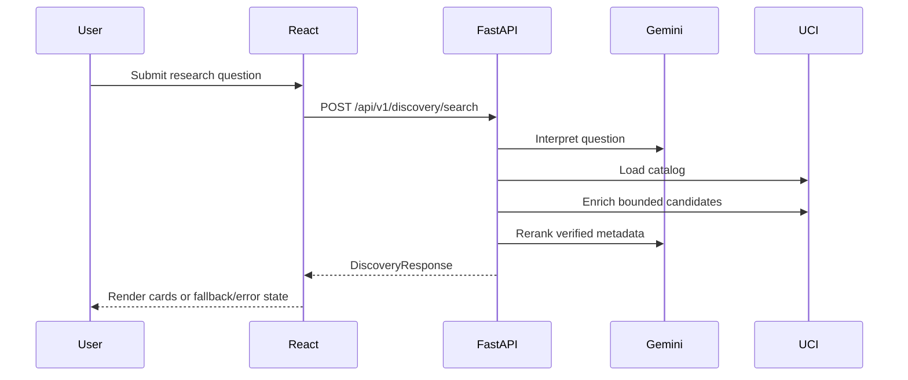

# Request Lifecycle and Asynchronous Behavior

Last verified: 2026-10-24

ResearchLens uses standard synchronous HTTP request/response interactions. It does **not** use WebSockets, Server-Sent Events, streaming Gemini responses, background workers, task queues, or distributed jobs.

## Search lifecycle

The frontend has a bounded fetch timeout and aborts the active search when a newer search starts. A request sequence prevents an older response from overwriting newer results. Backend discovery caches successful Gemini results for five minutes and fallback/partial results for 30 seconds.

## Analysis lifecycle

The frontend posts to `/datasets/{id}/analyze`. The backend retrieves metadata, interprets the question, fetches the original DataFrame, profiles it, and optionally requests Gemini suitability. Analysis results and DataFrames are process-local cached. Exploration reuses the in-memory DataFrame where available and returns grouped summaries synchronously.

Loading indicators are controlled independently for search, analysis, and exploration. Buttons are disabled while their operation is active. Errors are shown with retry actions where applicable. DEMO_MODE returns cached responses without external requests for its supported paths.

## Future considerations

Progress events or background jobs could help with slow external calls, but introducing them would change the current API and operational model. No such infrastructure is present.
